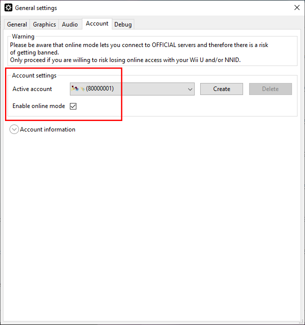

In this section, we look at how to enable online play on Cemu. The Nintendo servers have shut down, so you will need to connect to an alternative game service to play online: [Pretendo](https://pretendo.network/). This involves configuring the Pretendo network on your Wii U according to the [instructions available at their website](https://pretendo.network/docs/install/wiiu), then using Dumpling to dump the set of online files from your Wii U and installing them to Cemu. This means you will be able to play online with both other Cemu users and real Wii U users.

If you do not plan on using online services you may skip this page. 

## Required Reading

As a general rule of thumb, do not:
- Use mods, cheats or hacks
- Share your online files for other people to use
- Use the same account on multiple devices at the same time, e.g., on both your console and Cemu, as it will kick one or all players offline in most games

::: warning

##### Regarding reformatting or selling your Wii U Console:

- Reformatting your console will result in your PNID being unlinked from that console. You will no longer be able to use online features on Cemu until you re-link your account to that console and re-obtain the files necessary for online play.

- Selling your console (which is not permitted by Cemu because you technically do not own that data anymore) will likely also result in the new owner reformatting the console or otherwise removing your account from the same. This will result in permanent loss of access.

**If you want to play online with Cemu, keep your Wii U console.**

:::

## Requirements

- A Pretendo PNID set up on your Wii U and tested working (essential to collect Pretendo certificates)
- Online files dumped from your Wii U ([Using Dumpling](/using-dumpling))
- Online files installed into Cemu ([Copying Online Files to Cemu](/using-dumpling.html#copying-online-files-to-cemu))

## Enabling Online Mode

1. Open the Cemu emulator
1. On the top bar, go to **Options** -> **General settings**
1. Navigate to the **Account** tab
1. Ensure you have read the text at the top of the page
1. Check the box **Pretendo**

If you want to connect to a custom server that is not Pretendo, Select the custom button and put the network_services.xml file in your cemu folder. The custom server will provide a network_services.xml

Your Wii U should now be ready to go online. If you ever want to disable online features, simply check the box **Offline**.

